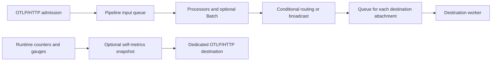

# Architecture

`core/data` owns the signal envelope and reuses generated protocol models from
moonbit-community/opentelemetry 0.1.8 (Apache-2.0). No copied protobuf schema.
`core/component` owns registry metadata and lifecycle contracts. Processors
run in configured order. Each pipeline/exporter attachment has its own queue
and worker; retrying one destination must not block other destinations.
When configured, routing evaluates processed records and groups their
destination copies. Each target counts its own accepted, delivered and lost
records. A destination shared across pipelines serializes its own sends.
The [routing and self-metrics contract](docs/ROUTING_AND_SELF_METRICS.md)
explains fallback and metric sampling.

The design borrows the component and service pipeline separation of the Go
OpenTelemetry Collector: https://github.com/open-telemetry/opentelemetry-collector.
That project is Apache-2.0; the reference covers architecture, not copied Go
source. [Ecosystem positioning](docs/ECOSYSTEM.md) distinguishes the Collector
from related MoonBit instrumentation libraries and describes independent work.
Protocol reference: https://opentelemetry.io/docs/specs/otlp/.

Acceptance means queued in volatile memory. A crash can lose queued data;
transport retries can duplicate records. There is no exactly-once guarantee.
Shutdown stops admission, flushes batches, drains workers and closes resources.
