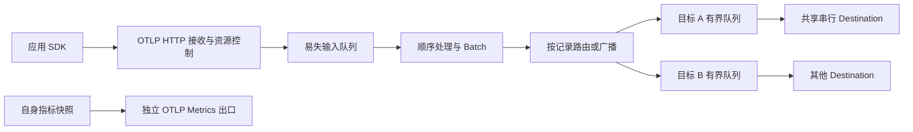

# MoonTelemetry

[](https://github.com/miik-su/MoonTelemetry/actions/workflows/ci.yml)

MoonBit Native 可观测性 Collector：独立接收 Logs、Metrics、Traces，按顺序处理，
通过独立有界队列转发到 Debug、轮转 JSONL 文件和 OTLP/HTTP 目标。
当前源码为 **0.1.4，实验阶段**。安装方式及注册表状态见[发布说明](docs/DISTRIBUTION.md)。

应用使用 SDK 产生遥测，MoonTelemetry 负责独立接收与处理。核心、网络、CLI、
处理器、测试及维护自动化使用 MoonBit，RSS 观测使用小型原生 C shim。
协议模型与 async I/O 复用依赖，独立贡献及参考范围见[生态定位](docs/ECOSYSTEM.md)。



## 功能与边界

| 部分 | 当前行为 |
| --- | --- |
| Receiver | `/v1/logs`、`/v1/metrics`、`/v1/traces`；JSON、Protobuf、gzip；鉴权、来源限制和大小／时间／复杂度边界 |
| 模型 | Logs、Traces；Gauge、Sum、Histogram、ExponentialHistogram、Summary；精确 64 位整数与明确的未知字段规则 |
| Processor | 大小保护、Resource／记录属性、递归脱敏、Batch；有界 all/any/not、属性存在／等值／前缀、资源属性、日志严重度过滤 |
| Exporter | Debug、轮转 JSONL、OTLP HTTP JSON／Protobuf；重试、连接复用、总期限及逐目标计数 |
| 条件路由 | 处理后按记录匹配，可发送给多个目标，同一目标去重，未匹配走显式兜底 |
| 自身指标 | 可选独立 OTLP/HTTP 推送，包含累计计数和内存／连接 Gauge |
| 运维／扩展 | live/ready、独立健康鉴权、预算及 RSS、导出耗时；插件 API v1、工厂和有界关闭，验证了 Windows 控制台 Ctrl+Break |

HTTP 200 表示进入易失输入队列。过滤、目标队列溢出、导出失败仍可发生；重试可能重复。
没有持久化、exactly-once、硬 RSS 上限或完整 OTLP 一致性认证。
普通解码／重编码可能丢弃未知 Protobuf 字段。指标和链路以结构校验为主。
gRPC、接收端 TLS、YAML、Profiles 和 Prometheus 抓取端点尚未实现。
详情见[兼容矩阵](COMPATIBILITY.md)、[范围](SCOPE.md)和[交付语义](docs/OPERATIONS.md)。
启用方式见[路由和自身指标示例](docs/ROUTING_AND_SELF_METRICS.md)。

## 快速开始

已验证工具链：`moon 0.1.20261104` / `moonc 0.10.20+65efd5b93`，Native。
需要 Native C 编译器；Windows 使用 MSVC，Linux 需满足 async 原生／HTTPS 系统依赖。
先用 `moon version --all` 确认命中的版本；系统旧版可能与 CI 固定工具链不同。

```sh
moon update
moon run examples/codec-demo --target native
moon run cmd/moontelemetry --target native -- validate --config examples/collector.json
moon run cmd/moontelemetry --target native -- run --config examples/collector.json
```

codec-demo 无需服务器，验证一个 LogRecord 的编码往返。Collector 默认监听
`127.0.0.1:4318`；另开终端发送真实 MoonBit SDK 数据：

```sh
moon run examples/sdk-demo --target native
```

等待批处理导出后检查当前目录的 `telemetry.jsonl`。在一个干净输出文件中，演示产生
一个 LogRecord、一个 Metric DataPoint 和一个 Span；重复运行会追加数据。
SDK 的退出提示不是后端送达证明，必须查看文件／目标统计。用 Ctrl+C 停止 Collector
并尝试有界排空；异常终止可能丢失尚未交付的数据。

需要自动复查完整流程时运行：

```sh
moon run tools/check_quickstart.mbtx --target native
```

它使用独立 SDK／Collector 进程、临时端口与 `_build/quickstart` 输出，实际核对三类记录。
这是功能冒烟，不是独占容量或 Windows 控制台信号测试。

## 配置与安全

- [普通示例](examples/collector.json)：保留正文，适合本地合成数据开发。
- [严格隐私示例](examples/strict-security.json)：设置独立的 ingest／health token，遮盖正文并移除非允许属性。
- [过滤示例](examples/filtered-collector.json)：只删除明确标记、开发环境中的低严重度日志；[规则说明](docs/FILTERING.md)。
- [部署模板](docs/DEPLOYMENT.md)：Linux CI 已验证 Compose 与 TLS 代理，目标主机需要单独验收。

配置与插件为可信管理输入，Endpoint 校验不是 SSRF 沙箱；远程 HTTP 需可信 TLS 终止。
逻辑预算与实际 RSS 分开观测；文件保留策略不是磁盘配额。
安全报告流程与测试边界见 [SECURITY](SECURITY.md) 和[威胁模型](docs/THREAT_MODEL.md)。

## 验证与维护

[24 小时本机混合负载](docs/results/2026-11-26/README.md)记录三类信号的逐目标送达量和资源采样。
[部署、控制台和依赖校验](docs/results/2026-11-23/README.md)另有按提交保存的验证证据。
条件路由与自身指标测试见 [0.1.4 验证页](docs/results/2026-11-22/README.md)。

CI 对选定包、格式、生成接口、模型描述符、发行包和示例进行检查；独立工作流验证
官方 Go Collector 互操作、覆盖反馈模糊测试与故障行为。**没有运行全量测试。**
各项结果必须按源提交和日期解读，当前状态以相应提交的 Actions 结果为准。

一个保留的历史例子：`89ed4eb` 在 Windows 同进程合成负载下运行一小时／32 客户端，
7,958,982 次接收并交付，7,883 次 503，0 传输错误。它不代表当前候选重新长测或生产容量。
[原始结果与限制](docs/results/2026-11-13/README.md)；[当前及历史证据索引](docs/VALIDATION.md)。

[维护路线](docs/MAINTENANCE.md) · [变更记录](CHANGELOG.md) ·
[插件契约](docs/PLUGINS.md) · [数据模型](docs/DATA_MODEL.md) ·
[使用与发布状态](docs/DISTRIBUTION.md) · [贡献规则](CONTRIBUTING.md)

Apache-2.0，见 [LICENSE](LICENSE) 与 [NOTICE](NOTICE)。依赖、生成模型、fixtures 和
架构参考的来源／许可见 [THIRD_PARTY_NOTICES](THIRD_PARTY_NOTICES.md)。
软件许可、协议能力与运行数据权利的区别见[契约说明](docs/CONTRACTS.md)。
本项目为独立实现，不代表 OpenTelemetry 或 CNCF 官方认可。
