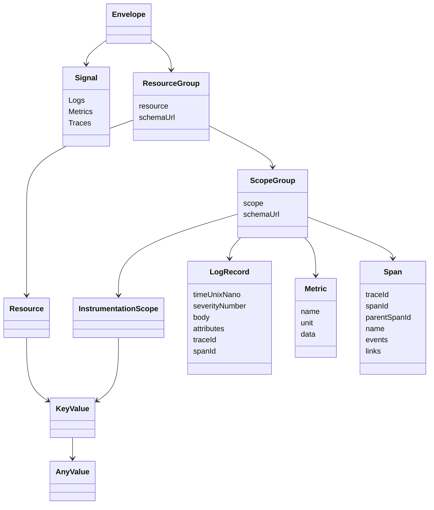
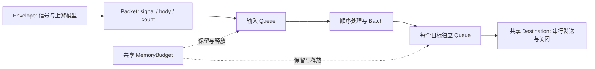

# MoonTelemetry 数据模型

MoonTelemetry 复用 `moonbit-community/opentelemetry@0.1.8` 的生成模型，
没有另建一套遥测结构。以下是阅读代码和测试结果所需的概念视图，完整字段以
[生成接口](../core/data/pkg.generated.mbti)、上游模型和[兼容性说明](../COMPATIBILITY.md)为准。

## 三类信号



`ResourceGroup` 和 `ScopeGroup` 是图中的概念简称；实际协议分别使用
`ResourceLogs / ResourceMetrics / ResourceSpans` 和对应的 `Scope*` 消息。
不会把三种信号的记录混入同一个协议数组。

| 信号 | 根字段／路径 | 记录 | 结果计数单位 |
| --- | --- | --- | --- |
| Logs | `resourceLogs` / `/v1/logs` | `scopeLogs[].logRecords[]` | LogRecord |
| Metrics | `resourceMetrics` / `/v1/metrics` | `scopeMetrics[].metrics[]` | DataPoint，不是 Metric 容器 |
| Traces | `resourceSpans` / `/v1/traces` | `scopeSpans[].spans[]` | Span |

Metric 的数据分支为 Gauge、Sum、Histogram、ExponentialHistogram、Summary。
每个 Metric 只选择一个分支；数值数据点的 `asInt / asDouble` 也属于 oneof。

## AnyValue 与整数

属性由 `key` 和 `value` 组成。AnyValue 选择字符串、布尔、64 位整数、浮点、
字节、数组或 KeyValue 列表等一个分支；例如：

```json
{
  "attributes": [
    { "key": "service.name", "value": { "stringValue": "checkout" } },
    { "key": "attempt", "value": { "intValue": "9223372036854775807" } },
    { "key": "cached", "value": { "boolValue": true } }
  ]
}
```

这是模型示意，不是一次实测输出。64 位整数输出为十进制字符串；输入也接受
精确整数数字形式。JSON 中的 trace/span ID 是十六进制，Protobuf 中是字节。
Span 和 Link 需要有效非零 trace/span ID；根 Span 的 parentSpanId 可以为空。

浮点字段也接受带引号的有限数（如 `"1.5"`、`"1e2"`），输出为数值。
`"NaN"`、`"Infinity"`、`"-Infinity"` 保留为特殊字符串；普通数字或数字字符串
溢出到无穷时被拒绝。这些规则同时用于 AnyValue、数据点和重复浮点边界。

## Collector 内部及健康模型



Envelope 的已知消息保留生成模型；遇到未来枚举值时使用带信号、wire bytes
和规范化 JSON 的兼容分支。它不意味着能够理解任意未来协议字段。
即使没有转换型处理器，普通已知消息的 Protobuf 解码／重编码也会丢弃未知字段；
详见 `core/data/unknown_fields_wbtest.mbt` 的根消息和嵌套字段注入测试。

收尾后每个队列的 `accepted = delivered + dropped + shutdownLost`。
`overflowDropped` 是进入该队列前被拒绝的计数，不含在其 `accepted` 中。
入口 HTTP 200 也不等于每个输出目标都交付成功：应逐个目标核对溢出、发送失败
和关闭损失。最新慢下游实测的三项分解见[结果页](results/2026-11-13/README.md)。

| 状态字段 | 类型与含义 |
| --- | --- |
| `status` | `created / ready / draining / closed` |
| `logicalMemoryUsed / requestMemoryUsed` | 十进制字符串，逻辑字节预算 |
| `rssBytes` | 十进制字符串或 null，实际进程观测，非预算上限 |
| `receivers` | 按 receiver ID 分组的请求、拒绝、超时、连接计数 |
| `pipelines[].input / outputs[]` | accepted、delivered、dropped、overflowDropped、shutdownLost、queuedBatches、retainedBytes |
| `outputs[].destination` | componentId、成功／失败批次、重试次数、拒绝记录、安全错误类别 |
| `processorFailedRecords / filtered` | 处理失败和主动过滤分别计数 |

计数可能使用字符串避免 64 位精度损失，队列长度等较小数值使用 JSON Number。
共享 Destination 的统计会在不同 pipeline 下重复展示，不能直接相加。
输入 delivered 表示处理完成；输出 delivered 表示出口接受或文件写入完成，均不保证持久化。
查看[真实健康快照](results/2026-11-08/soak-600.raw.json)及[运行语义](OPERATIONS.md)。

## 测试结果模型

历史汇总在 `summary.json` 中保存环境、来源、`runs[]` 和限制；原始 benchmark
保留 `seconds / concurrency / accepted / rejected / transportErrors`、
吞吐、延迟采样、RSS 和完整 `collector` 健康数据。
互操作结果包含 `source / returned` 两份健康快照和执行断言后的 `assertions`。
Schema 只描述本项目结果文件，不替代官方 OTLP Schema。
