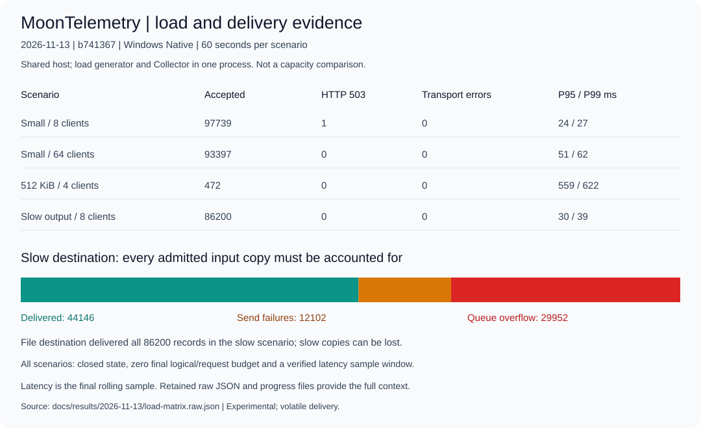

# 2026-11-13 验证证据

本目录只含合成遥测和测试元数据，不含客户数据。不同测试分别记录来源提交；
不能把历史测试、未记录提交的本地结果或运行中的测试解释为最新版本已全部通过。
使用 moon 0.1.20261104 / moonc 0.10.20+65efd5b93。

| 证据 | 已观察结果 | 来源与限制 |
| --- | --- | --- |
| [关键包测试汇总](tests.json) | Linux 74 / Windows 73 项通过；协议 22，集成 Linux 27 / Windows 26 | 118d469；11 个选定包，实际 CI 日志计数；未运行全量测试 |
| [扩展互操作原始结果](expanded-interop.raw.json) | 24 批回传，20 Logs / 28 Metric points / 16 Spans，逐批内容相等；9 个差分用例 | Windows Native，a0d631b；官方 Go Collector 0.165.0；覆盖指定 fixture，不能外推全部 OTLP |
| [覆盖反馈模糊测试](coverage-fuzz-local.raw.json) | 1,024 次变异，936 个命中计数器槽，26 个有新覆盖的输入，0 崩溃 | Windows Native，本地工作树未记录完整提交；不是覆盖率百分比或 ASan 结果；[独立 Linux CI](https://github.com/miik-su/MoonTelemetry/actions/runs/43366262332) 亦通过 |
| [依赖清单](dependencies-local.cdx.json) | 三个直接／传递模块的版本、来源和许可符合策略 | 本地工作树；SHA-256 仅覆盖 manifest，不证明整个依赖包完整性或没有漏洞 |
| [Linux 生命周期原始结果](lifecycle-linux.raw.json) | SIGINT、SIGTERM 均完成待发送记录落盘；强杀后重启不恢复易失记录 | 从 [46e6f2f CI 日志](https://github.com/miik-su/MoonTelemetry/actions/runs/43416878418) 原样提取 JSON；每种信号一个待发送记录 |
| 实际 ENOSPC | `/dev/full` 写入失败被计数，预算归零 | 同一次 Linux CI 明确执行 1 个测试并通过；低层 Destination 测试，不代表整个服务磁盘耗尽恢复 |
| [浮点边界互操作](float-interop.raw.json) | 保持 24 批模型往返；差分增加至 14 项 | Windows Native，68e863d；quoted finite / NaN / repeated double 接受，数字与字符串溢出均拒绝，与 Go 一致 |
| [Linux 固定语料重放](corpus-replay-linux.raw.json) | 26/26 通过 | 2254dd9 CI 日志提取；非法输入可拒绝，已接收模型必须编码往返一致 |
| [Linux 扩展种子模糊测试](coverage-fuzz-linux.raw.json) | 1,024 次变异、941 个命中槽、30 个新覆盖输入、0 崩溃 | 同一次 CI；输入加入固定语料，因此不与初始 Windows 936 槽结果当作覆盖率横向比较 |

扩展 fixture 包含五种指标、负指数直方图偏移、exemplar、精确整数边界、
AnyValue、资源／scope、Span 父子关系／link／event。
双方对全零 ID、重复 JSON 键的接受策略不同；超大请求均拒绝但状态码不同。
这些差异在原始结果中保留，详见[协议边界](../../../COMPATIBILITY.md)。

## 修正采样后的 60 秒场景矩阵



[完整原始结果](load-matrix.raw.json)，源码 b741367，Windows x64 Native release。
四组均验证延迟窗口序号连续、正常关闭、逻辑／请求预算归零及队列计数守恒。

| 场景／客户端 | 接收 | HTTP 503 | 传输错误 | P95 / P99 毫秒 |
| --- | ---: | ---: | ---: | ---: |
| 小请求／8 | 97,739 | 1 | 0 | 24 / 27 |
| 小请求／64 | 93,397 | 0 | 0 | 51 / 62 |
| 512 KiB 大请求／4 | 472 | 0 | 0 | 559 / 622 |
| 慢下游恢复／8 | 86,200 | 0 | 0 | 30 / 39 |

四组的文件目标均交付全部已接收记录。慢目标先延迟 2 秒，客户端尝试超时为
200 毫秒，测试中途恢复即时响应；恢复后 221 毫秒观察到首次成功。
该目标交付 44,146 条、发送失败 12,102 条、入目标队列前溢出 29,952 条，
三者合计 86,200 条。不能用入口零错误掩盖 best_effort 下游副本损失。
各组进度文件也保存在本目录，供核查采样 RSS 与排队状态。

## 旧版采样器的 1 小时结果

[原始结果](soak-3600-before-sampling-fix.raw.json)与
[进度记录](soak-3600-before-sampling-fix.progress.ndjson)来自 a0d631b、
Windows Native、32 个客户端、3,600 秒小请求负载。
8,846,531 个已接收请求全部交付，48,942 次 HTTP 503，11 次传输错误；
最终逻辑与请求预算均为零。

后续发现测试工具在超时清理的让出点重复分配采样序号，影响延迟窗口和进度采样。
因此保留原始文件，但不将其 P50/P95/P99 或采样 RSS 峰值作为合格性能证据。
这不是 Collector 停止响应的证据，也不能把 11 次传输错误写成零。
修正后的测试使用 `latencySequenceVerified` 检查延迟窗口完整性。

## 复现与工件

```sh
moon run tools/run_external_interop.mbtx --target native
moon build tests/fuzzcase --target native --enable-coverage
moon run tools/coverage_fuzz.mbtx --target native
moon build benchmarks/collector --release --target native --target-dir _build/matrix-tests
moon run tools/run_load_matrix.mbtx --target native
```

设置 `MOONTELEMETRY_BENCHMARK_REVISION` 为实际源码提交以记录负载来源。
矩阵依次执行 small/8、small/64、large/4、slow/8，每组 60 秒，输出位于
`_build/load-matrix/`。慢下游场景使用 best_effort，明确允许该目标副本失败／丢弃；
每个队列必须满足 accepted = delivered + dropped + shutdownLost，且收尾预算归零。
负载发生器和 Collector 处于同一进程，RSS 包含两者；同一主机可能同时进行开发，
不能将这些结果视为独占环境容量、跨语言性能比较或生产服务等级承诺。

CI 的 Summary 和 Artifacts 另存平台／提交及合成原始结果，保留 30 天。
原始结果中的时间戳为 Unix 毫秒字符串，计数器和 64 位数值也可能使用十进制字符串。
关键包测试范围见[验证记录](../../VALIDATION.md)，没有执行全量测试。

仓库内还保存了[26 个可重放的合成变异样本](../../../tests/fuzz-corpus/README.md)。
`moon run tools/replay_fuzz_corpus.mbtx --target native` 会重放这些输入；
后续覆盖反馈运行也把它们作为起始语料，避免只保存在临时 CI Artifacts 中。
本地已重放 26/26 通过；[2254dd9 Linux CI](https://github.com/miik-su/MoonTelemetry/actions/runs/43417808074)
完成了固定语料重放和后续 1,024 次变异。
负载矩阵另设 [Windows/Linux 独立工作流](https://github.com/miik-su/MoonTelemetry/actions/workflows/load-matrix.yml)，
在相关工具修改时或手动启动，每组仅 60 秒，分别保留原始工件。
图表通过 `moon run tools/render_current_results.mbtx --target native` 从原始文件生成，
CI 校验图表与数据一致。
