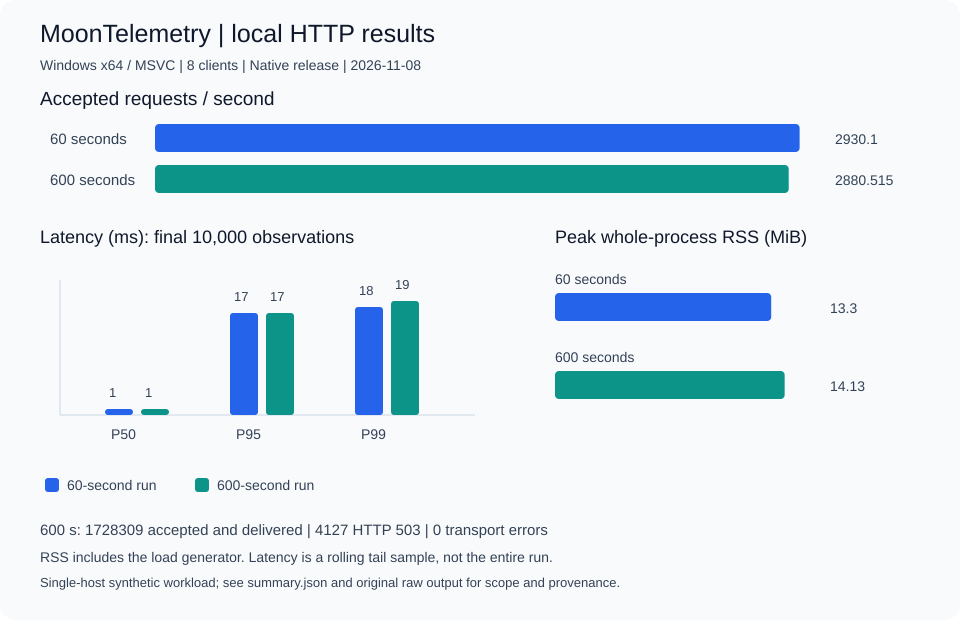
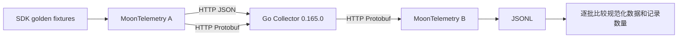

# 测试结果与数据展示

这里保存可直接查看的图表、机器可读结果和来源说明。历史快照不会被后续 CI 覆盖。

最新证据见 [2026-11-13 验证页](2026-11-13/README.md)：扩展模型与真实互操作、
编译器覆盖反馈模糊测试、依赖清单、Linux 信号／强杀／重启及 ENOSPC 检查。
其中 1 小时旧采样器数据明确标记限制，并保留 11 次传输错误。
下图和下方 60／600 秒表格均是 2026-11-08 历史快照。

## 历史负载测试

| 指标 | 60 秒 | 600 秒 |
| --- | ---: | ---: |
| 并发客户端 | 8 | 8 |
| 接收并交付的请求 | 175,806 | 1,728,309 |
| 拒绝请求 | 374 | 4,127（均为 HTTP 503） |
| 传输错误 | 0 | 0 |
| 接收请求／秒 | 2,930.1 | 2,880.515 |
| P50 / P95 / P99，毫秒 | 1 / 17 / 18 | 1 / 17 / 19 |
| 整个测试进程 RSS 峰值，字节 | 13,950,976 | 14,819,328 |
| 溢出／关闭损失 | 0 / 0 | 0 / 0 |

数据来自 Windows x64 / MSVC、旧版 0.10.17 编译器的本机合成日志测试。
RSS 包含负载发生器；延迟来自最后 10,000 次观测；不同持续时间不是不同配置或语言的性能对比。
503 是接收前的限流拒绝，不能计作成功交付。结果不代表生产容量或多小时稳定性保证。

- [历史汇总 JSON](2026-11-08/summary.json)：含环境、单位、来源及限制。
- [600 秒原始输出](2026-11-08/soak-600.raw.json)：从保留的 stdout 直接同步，含完整 Collector 状态。
- 60 秒原始 stdout 没有保留；JSON 中明确标记为根据已有性能报告转录，未补造原始日志。
- [性能说明与复现命令](../PERFORMANCE.md)。

## 关键测试与真实互操作

| 验证 | 已记录结果 | 证据 |
| --- | --- | --- |
| 本地关键包 | 协议 16、配置 7、集成 19 项通过 | [测试快照](2026-11-08/tests.json) |
| Windows/Linux CI | 固定工具链，关键包、格式、生成接口检查通过 | [版本检查记录](https://github.com/miik-su/MoonTelemetry/actions/runs/42494274493) |
| 2026-11-10 Go Collector 双向互操作 | 6 个入口请求 → 双编码转发 → 12 个回传请求 | [本次原始结果](2026-11-10/interop.raw.json) |
| 回传内容 | 4 条日志、8 个指标点、4 个 Span；规范化内容逐批等于源 fixture | [测试实现](../../tests/external/main.mbt) |

互操作使用官方 Go Collector 0.165.0、MoonBit 0.10.20+65efd5b93、Windows Native。
官方归档的校验信息和测试配置见[验收记录](../VALIDATION.md)及
[Go 配置](../../examples/interop/otelcol.yaml)。重新运行只新增了可选结果输出；Collector 实现基于 v0.1.1。
所有记录使用合成 fixture，不含真实客户遥测。

本地测试数字来自已记录的命令汇总，不是完整逐用例日志；详细 CI 日志在相应运行页中。
只执行关键包，不执行全量测试；不能将这些记录解释为完整覆盖率或安全认证。

## 数据模型与下载

- [遥测数据模型](../DATA_MODEL.md)：三类信号、AnyValue、Envelope、队列与健康状态。
- [Benchmark 结果 JSON Schema](schemas/benchmark.schema.json)。
- [互操作结果 JSON Schema](schemas/interop.schema.json)。
- [完整 Logs fixture](../../tests/fixtures/logs.json)、[Metrics fixture](../../tests/fixtures/metrics.json)、[Traces fixture](../../tests/fixtures/traces.json)。
- [Fixture 来源与许可](../../tests/fixtures/README.md)。

## 最新 CI 自动结果

进入 [Native key checks](https://github.com/miik-su/MoonTelemetry/actions/workflows/ci.yml)，
选择一次成功运行，可在 Summary 查看每个平台的关键检查及 5 秒 HTTP 冒烟数据。
Artifacts 中的 `validation-results-ubuntu-latest` / `validation-results-windows-latest`
包含原始 benchmark JSON、运行平台／提交信息和 Markdown 摘要，保留 30 天。
这些是共享 Runner 的短测结果，与上面的本机历史负载数据分别记录。
若前置检查失败，不会生成“全部通过”的摘要；失败详情以 CI 日志为准。

重新生成历史图表：`moon run tools/render_results.mbtx`。该脚本会先核对
600 秒原始结果与汇总，再生成 SVG；CI 会检查生成结果是否与提交一致。
